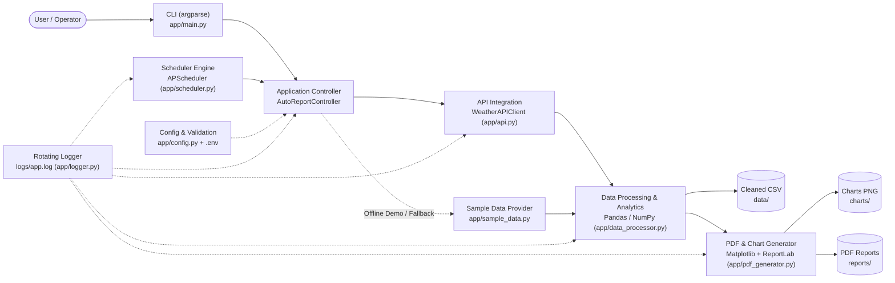

# AutoReport – Enterprise PDF Report Automation System

## 1. Project Title

**AutoReport – Enterprise PDF Report Automation System**

---

## 2. Project Overview

AutoReport is a production-quality Python automation application that collects meteorological forecast data from a live REST API, cleans and analyzes the dataset using Pandas and NumPy, produces high-resolution statistical charts with Matplotlib, and compiles formatted multi-page executive PDF reports with ReportLab. It supports interactive and unattended execution through a structured `argparse` CLI and an APScheduler-based scheduling engine, along with an offline demonstration mode for resilience when external connectivity is unavailable.

---

## 3. Problem Statement

Organizations and engineering teams frequently rely on manual workflows to fetch external operational data, clean anomalies in spreadsheets, create charts, and assemble formatted reports. Manual reporting is time-consuming, error-prone, inconsistent across runs, and difficult to scale to recurring schedules. AutoReport solves this by automating the entire ingestion, transformation, visualization, PDF rendering, and scheduling pipeline in a single modular, testable Python package.

---

## 4. Project Objectives

- Automate end-to-end weather data retrieval from the public Open-Meteo REST API without requiring API keys.
- Implement resilient data cleaning, missing-value imputation, duplicate removal, and statistical analysis with Pandas and NumPy.
- Render executive-grade PDF reports containing summary KPIs, tabular daily breakdowns, embedded Matplotlib charts, analytical insights, and paginated footers.
- Provide recurring automated execution via APScheduler with error isolation and graceful shutdown.
- Expose all capabilities through an installable `autoreport` CLI (`pip install -e .`) backed by centralized configuration, rotating file logs, and an automated Pytest suite.

---

## 5. Key Features

- **REST API Integration**: Connects to the Open-Meteo Forecast API using `requests.Session` with configurable timeouts, HTTP error handling (including 429 rate-limit detection), and JSON schema validation.
- **Data Cleaning & Analytics**: Chronological sorting, date deduplication, linear/mean imputation, WMO weather code decoding, NumPy statistical summaries, and automated linear trend insights.
- **Professional PDF Reporting**: Generates A4 corporate-styled PDFs with ReportLab (`NumberedCanvas` `Page X of Y` footers) and three embedded 150-DPI Matplotlib charts (Temperature Trend, Max vs. Min Comparison, Precipitation Forecast).
- **Automated Scheduling**: Supports `daily` (cron `HH:MM`), `hourly`, and `minutes` triggers, plus bounded verification (`--run-now --max-runs 1`), `SIGINT`/`SIGTERM` graceful shutdown, and job error isolation.
- **Offline Demonstration Mode**: Separate sample-data provider (`--demo` or optional `--fallback`) clearly marked as simulated demonstration data—never misrepresented as live API data.
- **Centralized Config & Logging**: Powered by `python-dotenv` (`.env`) and `RotatingFileHandler` writing structured records to `logs/app.log`.

---

## 6. Technology Stack

| Component | Technology |
| :--- | :--- |
| Language | Python 3.11+ |
| HTTP Client | `requests` |
| Data Processing & Math | `pandas`, `numpy` |
| Charting | `matplotlib` (`Agg` backend) |
| PDF Generation | `reportlab` |
| Task Scheduling | `APScheduler` |
| Configuration | `python-dotenv` |
| CLI | `argparse` (Standard Library) |
| Testing | `pytest`, `pdfplumber` |
| Packaging | `pyproject.toml` (`setuptools`) |

---

## 7. System Architecture



---

## 8. Project Folder Structure

```text
task5_autoreport/
├── app/
│   ├── __init__.py          # Package metadata and exported exceptions
│   ├── exceptions.py        # Domain-specific exception hierarchy
│   ├── config.py            # Centralized AppConfig, .env loading, input validation
│   ├── logger.py            # Rotating file logger writing to logs/app.log
│   ├── api.py               # Open-Meteo REST API client & response validator
│   ├── sample_data.py       # Offline demonstration dataset generator
│   ├── data_processor.py    # Pandas/NumPy cleaning, stats, and insight generation
│   ├── pdf_generator.py     # Matplotlib charts & ReportLab PDF builder
│   ├── scheduler.py         # APScheduler wrapper with graceful shutdown
│   └── main.py              # AutoReportController and argparse CLI entrypoint
├── data/                    # Cleaned CSV exports
├── reports/                 # Generated PDF reports
├── logs/                    # Application logs (app.log)
├── charts/                  # Generated Matplotlib PNG charts
├── tests/
│   ├── __init__.py
│   ├── test_api.py          # API client & error handling unit tests
│   ├── test_processor.py    # Data cleaning, stats, and sample data tests
│   ├── test_pdf_generator.py# PDF & chart rendering verification tests
│   ├── test_scheduler.py    # APScheduler configuration & execution tests
│   └── test_cli.py          # End-to-end CLI command tests
├── .env.example             # Sample environment configuration template
├── .gitignore
├── LICENSE
├── pyproject.toml           # Modern Python packaging & console script config
└── requirements.txt         # Runtime and test dependencies
```

---

## 9. Installation Instructions

Ensure **Python 3.11 or newer** is installed on your system, then clone or navigate into the project directory:

```bash
cd task5_autoreport
```

---

## 10. Virtual Environment Setup

Create and activate an isolated Python virtual environment:

**Windows (PowerShell):**

```powershell
python -m venv .venv
.\.venv\Scripts\Activate.ps1
```

**macOS / Linux:**

```bash
python3 -m venv .venv
source .venv/bin/activate
```

---

## 11. Dependency Installation

Install dependencies and register the `autoreport` CLI command in editable mode:

```bash
pip install -r requirements.txt
pip install -e .
```

Verify installation:

```bash
autoreport --help
```

---

## 12. Configuration Instructions

Copy `.env.example` to `.env` to customize defaults without modifying source code:

```bash
cp .env.example .env
```

Available environment variables:

- `AUTOREPORT_API_URL`: Weather API base URL (default: `https://api.open-meteo.com/v1/forecast`)
- `AUTOREPORT_REQUEST_TIMEOUT`: HTTP timeout in seconds (default: `15`)
- `AUTOREPORT_DEFAULT_LATITUDE`: Default latitude `[-90, 90]` (default: `11.0168`)
- `AUTOREPORT_DEFAULT_LONGITUDE`: Default longitude `[-180, 180]` (default: `76.9558`)
- `AUTOREPORT_DEFAULT_LOCATION_NAME`: Default display location label
- `AUTOREPORT_FORECAST_DAYS`: Forecast horizon `1..16` (default: `7`)
- `AUTOREPORT_TIMEZONE`: Timezone parameter sent to Open-Meteo (default: `auto`)
- `AUTOREPORT_LOG_LEVEL`: `DEBUG`, `INFO`, `WARNING`, `ERROR`, or `CRITICAL`
- `AUTOREPORT_SCHEDULE_INTERVAL`: `daily`, `hourly`, or `minutes`
- `AUTOREPORT_SCHEDULE_TIME`: 24-hour `HH:MM` daily execution time (default: `08:00`)
- `AUTOREPORT_SCHEDULE_INTERVAL_MINUTES`: Minute interval for `minutes` mode (default: `60`)

Validate configuration and directory write permissions at any time:

```bash
autoreport validate
```

---

## 13. API Integration Explanation

AutoReport integrates with the **Open-Meteo Weather Forecast API** (`https://api.open-meteo.com/v1/forecast`), which is free and requires no authentication token. `WeatherAPIClient` requests daily metrics (`temperature_2m_max`, `temperature_2m_min`, `temperature_2m_mean`, `precipitation_sum`, `windspeed_10m_max`, `weathercode`) plus `current_weather`.

Every response undergoes strict validation:
- Enforces configurable request timeouts (`APITimeoutError`).
- Catches network outages (`APIConnectionError`), HTTP `429` rate limits (`APIRateLimitError`), and non-2xx responses (`APIResponseError`).
- Verifies JSON integrity, presence of the `daily` object, required arrays, and equal series lengths before passing data downstream.

---

## 14. CLI Usage Examples

```bash
# Display help and available subcommands
autoreport --help

# Display application metadata and configuration paths
autoreport info

# Validate configuration and runtime directory permissions
autoreport validate

# Generate a live weather report for Coimbatore (11.0168, 76.9558)
autoreport generate --latitude 11.0168 --longitude 76.9558

# Generate a live weather report for Chennai with a custom label
autoreport generate --latitude 13.0827 --longitude 80.2707 --location "Chennai, India"

# Generate an offline demonstration report (no internet required)
autoreport generate --demo

# Attempt live API and fall back to labeled demonstration data if offline
autoreport generate --fallback

# Run daily automated scheduling at 08:00
autoreport schedule --interval daily --time 08:00
```

---

## 15. PDF Generation Instructions

Running `autoreport generate` performs the following steps automatically:
1. Collects weather data (live API or `--demo` sample dataset).
2. Cleans and analyzes daily metrics via `WeatherDataProcessor`, exporting a cleaned CSV to `data/`.
3. Renders three 150-DPI PNG charts into `charts/`:
   - Temperature trend line chart with min-max envelope
   - Maximum vs. minimum temperature grouped bar comparison
   - Daily precipitation forecast bar chart
4. Builds a paginated A4 PDF report in `reports/` (`weather_report_YYYYMMDD_HHMMSS.pdf`) containing all 10 required sections, embedded visualizations, and `Page X of Y` footers.

You can also specify a custom output path:

```bash
autoreport generate --demo --output reports/custom_demo_report.pdf
```

---

## 16. Scheduling Instructions

Use `autoreport schedule` to start APScheduler-driven automation:

```bash
# Daily schedule at 08:00
autoreport schedule --interval daily --time 08:00

# Hourly schedule
autoreport schedule --interval hourly

# Every 30 minutes
autoreport schedule --interval minutes --minutes 30

# Safe verification run (executes 1 cycle immediately in demo mode and shuts down)
autoreport schedule --interval daily --demo --run-now --max-runs 1
```

Press `Ctrl+C` (`SIGINT`) at any time for graceful shutdown. Scheduled job errors are logged to `logs/app.log` without terminating the scheduler loop.

---

## 17. Testing Instructions

Run the complete unit and CLI test suite with Pytest (all external API calls are mocked and temporary directories isolate file outputs):

```bash
pytest -v
```

---

## 18. Example Outputs

When executing `autoreport generate`, the CLI displays concise progress output:

```text
========================================
       AUTOREPORT AUTOMATION SYSTEM
========================================

[INFO] Connecting to weather API...
[SUCCESS] Data retrieved successfully.
[INFO] Processing weather information...
[SUCCESS] Data processing completed.
[INFO] Generating PDF report...
[SUCCESS] PDF report generated.

Report Location: reports/weather_report_YYYYMMDD_HHMMSS.pdf

========================================
```

Generated artifacts are placed in:
- `reports/` — Formatted PDF report(s)
- `charts/` — Rendered Matplotlib PNG figures
- `data/` — Cleaned CSV dataset(s)
- `logs/app.log` — Timestamped execution logs

---

## 19. Troubleshooting

| Issue | Resolution |
| :--- | :--- |
| `autoreport` command not found | Activate your virtual environment and run `pip install -e .`. |
| Connection or timeout error during `generate` | Check internet access, increase `AUTOREPORT_REQUEST_TIMEOUT`, or use `autoreport generate --demo` / `--fallback`. |
| Permission denied writing reports or logs | Run `autoreport validate` to verify write permissions on `data/`, `reports/`, `logs/`, and `charts/`. |
| Invalid latitude/longitude error | Ensure latitude is within `[-90, 90]` and longitude is within `[-180, 180]`. |

---

## 20. Future Enhancements

- Multi-location batch report compilation into a single regional executive PDF.
- Email / Slack webhook delivery plugin for automated distribution after scheduled runs.
- Historical SQLite/Parquet archive for multi-week rolling anomaly detection.
- Interactive HTML dashboard export alongside static PDF briefings.

---

## 21. Author and License Information

- **Author**: AutoReport Capstone Project Engineering Team
- **License**: MIT License — see [LICENSE](LICENSE) for full details.
